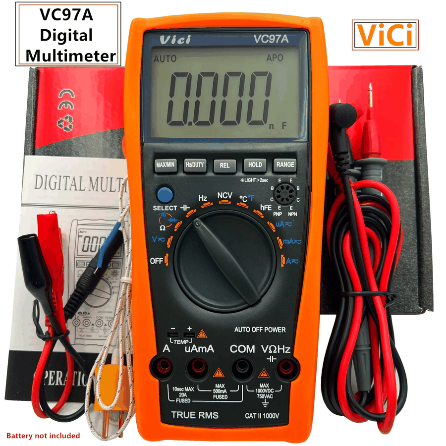
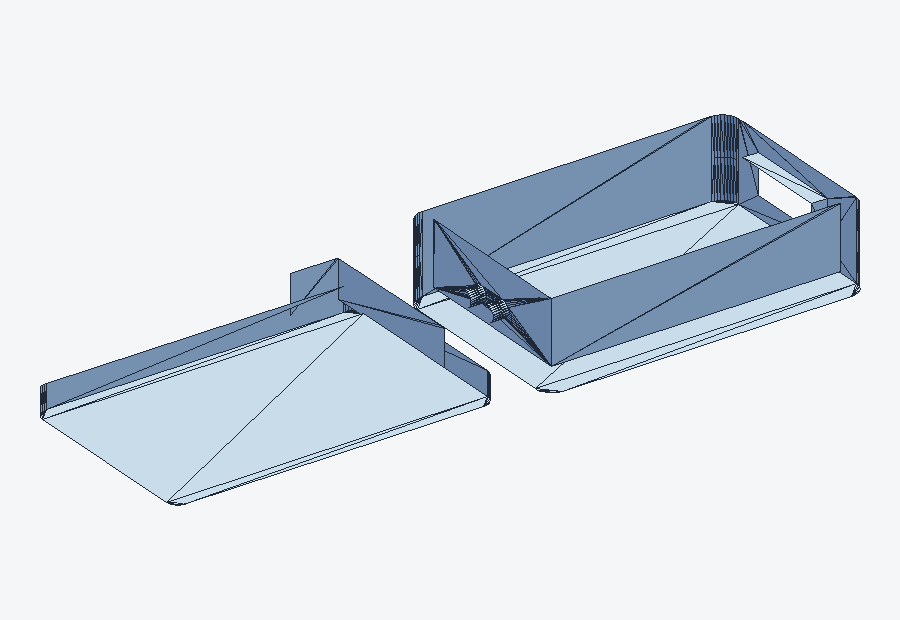

# VICI VC99 UART — aplikacja PC

<p align="center">
  
</p>

Aplikacja desktopowa dla Windows do odczytu, wizualizacji i analizy pomiarów
z multimetru **VICI VC99** podłączonego przez UART/RS232 (2400 8N1).

Poza podstawowym odczytem wartości oferuje: bargraf i trend, zapis CSV,
sygnalizację dźwiękową ciągłości i trybu diody, profil reflow **BGA HOT-AIR**
ze śledzeniem temperatury z termopary, estymację **SoC baterii** dla
kilkudziesięciu typów ogniw i pakietów, zakładkę **LCD** z zewnętrznym widokiem
HTML oraz zakładkę **Serwis** z diagnostyką tranzystorów **hFE**.


[](https://github.com/pmbb81-wq/Vici-VC99-UART/releases/latest)


## Zrzuty ekranu

| Pomiary | Opcje |
|---|---|
|  |  |

| BGA HOT-AIR | Battery SoC |
|---|---|
|  |  |

## Funkcje

### Pomiary
- Duży, czytelny odczyt wartości z jednostką i prefiksem (n, µ, m, k, M).
- Skala 6000 counts, bargraf 61 segmentów, mini-wykres trendu.
- Statystyki **Min / Max / AVG** oraz licznik próbek.
- Rozpoznawanie trybów: DC, AC, AUTO, HOLD, REL, MAX/MIN, APO, BAT, diode,
  ciągłość, hFE, Hz, F, °C/°F.
- Zapis pomiarów do **CSV**, zmiana koloru wyniku, motyw jasny/ciemny.
- Wybór portu COM, odświeżanie listy portów, automatyczne łączenie.
- **FPS** i opóźnienie od ostatniej ramki w pasku statusu.
- Surowa ramka w formacie HEX (diagnostyka).

### LCD
- Dodatkowa zakładka **LCD** z wiernym widokiem wyświetlacza VC99 w HTML
  (QtWebEngine), z bargrafem, ikonami trybów i animacją segmentów.
- Motyw LCD można zmienić w widoku HTML; wybór jest zapamiętywany w
  `QSettings` i przywracany po restarcie aplikacji.
- **Prawy przycisk myszy** na LCD przenosi ekran do osobnego okna — wygodne
  przy pracy na drugim monitorze. Ponowne kliknięcie lub przycisk
  **Przywróć LCD do zakładki** wraca do widoku wbudowanego.
- Wymagany jest plik `html/gemini-code-lcd 2.html` obok EXE. Plik jest
  dołączony do wydania 1.1.

### Opcje
- **Brzęczyk ciągłości** — próg rezystancji, częstotliwość, głośność, test.
- **Tryb diody (jak ZOYI 706S)** — 1 pisk dla zwykłej diody, 2 piski dla
  Schottky'ego, ciągły ton przy zwarciu; regulowane czasy pisków i przerwy.
- Mowa (TTS) — miejsce zarezerwowane na przyszłą funkcję.

### BGA HOT-AIR
- Czteroetapowy profil lutowania: **Preheat → Soak → Reflow → Cool**.
- Edytowalne czasy i temperatury każdego etapu.
- Gotowe presety: SAC305 (standard i rework), Sn63Pb37, Sn42Bi58.
- Wykres profilu z linią **liquidus** oraz nałożonym pomiarem rzeczywistym
  z termopary multimetru.
- Podpowiedzi na żywo (za zimno / za gorąco / OK), dźwięk przy zmianie etapu
  i na końcu profilu.
- Logowanie przebiegu do **CSV** i eksport wykresu do **PNG/JPG**
  (prawy przycisk myszy na wykresie).

### Battery SoC
- **33 profile** ogniw i pakietów: Li-ion/LiPo, LiHV, LiFePO4, NiMH, NiCd,
  NiZn, alkaliczne, Zn-C, Li-FeS2, srebrowe, cynkowo-powietrzne,
  CR2032/CR2016/CR123A, LR44, 9 V (alkaliczna/NiMH/litowa),
  pakiety narzędziowe 12/18/20/36/60 V, NiCd/NiMH 12/14,4/18 V,
  LiPo RC 2S/3S/6S, ołowiowe 6/12/24 V oraz LiFePO4 12/48 V.
- Automatyczne ustawianie liczby ogniw przy wyborze profilu.
- Napięcie całkowite i **V/ogniwo**, SoC z krzywej rozładowania,
  status (Pełna / OK / Niska / Krytyczna) i wykres charakterystyki.
- Profil własny (liniowy) oraz zapamiętywanie ustawień.

### Serwis
- Zakładka z kategoriami: **Laptopy**, **Komputery**, **Karty graficzne**
  (miejsca na przyszłe narzędzia) oraz **hFE**.
- **hFE — diagnostyka tranzystora** na podstawie pomiaru z multimetru:
  - `≤ 5` — brak tranzystora lub obwód rozwarty,
  - `6–9` — bardzo niska wartość, sprawdź osadzenie i styki,
  - `10–800` — tranzystor sprawny; dodatkowo klasy BC547:
    A `110–220`, B `200–450`, C `420–800`,
  - `801–900` — wysoka wartość, sprawdź pomiar,
  - `> 900` lub `O.L` — zwarcie/przebicie złącza C-E.
- **Parowanie NPN/PNP** dla par audio: zapisz bieżący pomiar jako NPN i PNP,
  a aplikacja obliczy różnicę względną
  `|NPN - PNP| / ((NPN + PNP) / 2) × 100%`.
  Poniżej `5%` — idealna para, `5–10%` — akceptowalna, powyżej `10%` — duża
  rozbieżność.
- Wartości parowania są przechowywane tylko w pamięci bieżącej sesji.

## Sprzęt i protokół

- Multimetr **VICI VC99** z wyjściem RS232 (lub przejściówką USB-RS232).
- Układ pomiarowy: **Fortune FS9922-DMM4**.
- Transmisja: **2400 baud, 8 bitów, bez parzystości, 1 bit stopu**.
- Ramka: **14 bajtów**, zakończona `0D 0A`.
- Zliczenia: 6000 counts, bargraf 61 segmentów.
- Przepływność: ok. **17 ramek/s** (~58 ms na ramkę).
- W VC99 transmisję włącza się **przytrzymaniem przycisku REL** — na
  wyświetlaczu pojawia się oznaczenie „RS232"; ponowne przytrzymanie wyłącza.

Szczegóły dekodowania bajtów opisuje `vici_vc99_protocol.txt` oraz noty
aplikacyjne w kodzie (`vc99_parser.py`).

Pełna dokumentacja układu:
[FS9922-DMM4-DS-15_EN.pdf](docs/FS9922-DMM4-DS-15_EN.pdf).

## Modyfikacja multimetru (UART)

- **Forum AMB Laboratories** — wątek
  „[DIY: hacking multimeters for RS232 data logging output](https://www.amb.org/forum/diy-hacking-multimeters-for-rs232-data-logging-output-t1210.html)”:
  wyprowadzenie sygnału RS232 z układu multimetru (m.in. VC99), odbiornik IR
  na fototranzystorze, schemat częściowy (D8/D9) oraz wskazówka o włączaniu
  transmisji przyciskiem **REL**. Warto przeczytać przed modyfikacją.
- **Mysku.club — „[Мультиметр Vici VC99 (Vichy VC99) — Модернизация](https://mysku.club/blog/aliexpress/32413.html)”**
  Szczegółowa modyfikacja VC99: wyprowadzenie **RS232 z pinu 92** układu
  FS9922-DMM4 (przez FTDI z separacją galwaniczną), podświetlenie LCD z pinu
  74 (długie przytrzymanie **HOLD**), przyspieszenie pracy przez zamianę kwarcu
  4 MHz na 8 MHz z przełącznikiem (w trybie turbo częstotliwość i pojemność
  są mierzone błędnie 2×) oraz zasilanie z Li-ion 16650 + TP4056. Artykuł
  zawiera schemat po modyfikacji i listę programów do logowania.
- **Film** — modyfikacja VC99 z czujnikiem TCRT5000:

  [](https://www.youtube.com/watch?v=FPksaFYixVQ)

## Obudowa 3D (STL)

Drukowana obudowa na moduł UART do VC99 — dwa elementy (korpus + pokrywa),
wymiary gabarytowe ok. **85 × 27 × 10 mm**. Plik do pobrania:
[stl-3d/uart2.stl](stl-3d/uart2.stl).

<p align="center">
  
</p>

Druk w skali **100%** (wymiary w milimetrach). Zalecane PLA lub PETG,
warstwa 0,2 mm, wypełnienie 20–30%.

## Recenzje i teardowny

- **EEVblog — „[Vichy VC99 Multimeter Review and Teardown](https://www.eevblog.com/forum/testgear/vichy-vc99-multimeter-review-and-teardown/)”**
  Recenzja i rozbiórka taniego (ok. 35 USD) multimetru. Potwierdza układ
  **FS9922-DMM4** (Fortune Semiconductor) oraz to, że wyprowadzenia RS232
  są dostępne na pinach układu, mimo braku złącza w obudowie. W wątku
  opisano także mod na bezprzewodowe logowanie (adapter Bluetooth RN-42)
  oraz uwagi o szybkości autorangi i trwałości przełącznika zakresów.
- **Digital Chip — „[Цифровой мультиметр Vichy VC99](https://digitalchip.ru/vichy-vc99/)”**
  Rosyjskojęzyczna recenzja z rozpakowaniem, zdjęciami i pełną tabelą
  specyfikacji (DCV/ACV, prąd, rezystancja, pojemność, częstotliwość, hFE,
  dioda, ciągłość, temperatura, termopara typu K). Dobre źródło danych
  katalogowych i wrażeń z użytkowania.

## Instalacja (gotowy EXE)

Pobierz najnowszą wersję:
**[Releases → VICI VC99 UART 1.1](https://github.com/pmbb81-wq/Vici-VC99-UART/releases/latest)**

1. Wejdź w zakładkę **Releases** tego repozytorium.
2. Pobierz `VICI_VC99_1.1_Windows.zip` (EXE + wymagany HTML) albo osobno
   `VICI_VC99_FINAL.exe` i `gemini-code-lcd 2.html`.
3. Rozpakuj pliki tak, aby zachować strukturę:
   ```
   VICI_VC99_FINAL.exe
   html\
     gemini-code-lcd 2.html
   ```
4. Podłącz multimetr, uruchom program i wybierz port COM.

Program nie wymaga instalacji Pythona ani dodatkowych bibliotek. Plik HTML
jest potrzebny tylko zakładce **LCD**; bez niego pozostałe funkcje działają
normalnie.

### Co nowego w wersji 1.1
- Nowa zakładka **LCD** z zewnętrznym widokiem HTML wyświetlacza VC99.
- Zapamiętywanie wybranego motywu LCD.
- Odłączanie LCD do osobnego okna prawym przyciskiem myszy.
- Nowa zakładka **Serwis** z kategoriami Laptopy, Komputery, Karty graficzne
  i hFE.
- Diagnostyka hFE z klasyfikacją tranzystora oraz parowaniem NPN/PNP.
- Opisy i podpowiedzi nowych opcji w interfejsie aplikacji.

## Uruchomienie ze źródeł

```powershell
python -m pip install -r requirements.txt
python vici-vc99-py/src/main.py
```

Wymagania: Python 3.9+ oraz PyQt5 i pyserial (patrz `requirements.txt`).

## Budowa pliku EXE

```powershell
cd vici-vc99-py/src
pyinstaller --clean --noconfirm VICI_VC99_FINAL.spec
```

Gotowy plik pojawi się w `vici-vc99-py/src/dist/VICI_VC99_FINAL.exe`.
Plik `html/gemini-code-lcd 2.html` nie jest osadzany w EXE — należy skopiować
go do folderu `html` obok pliku wykonywalnego.

## Struktura projektu

```
.
├── README.md
├── LICENSE                     # licencja MIT
├── requirements.txt
├── stl-3d/
│   └── uart2.stl               # obudowa do druku 3D
├── docs/
│   ├── FS9922-DMM4-DS-15_EN.pdf  # dokumentacja układu
│   ├── stl-preview.png         # podgląd obudowy
│   └── screenshots/            # zrzuty ekranu do README
├── html/
│   └── gemini-code-lcd 2.html  # widok LCD wymagany przez zakładkę LCD
├── vici_vc99_protocol.txt      # notatki o protokole ramki
└── vici-vc99-py/
    └── src/
        ├── main.py             # okno główne i wszystkie zakładki
        ├── widgets.py          # bargraf, trend, wykres BGA, krzywa baterii
        ├── lcd_view.py         # QtWebEngine, motyw LCD i menu kontekstowe
        ├── hfe_tool.py         # diagnostyka i parowanie tranzystorów hFE
        ├── buzzer.py           # generowanie tonów i wzorów pisków (winsound)
        ├── vc99_parser.py      # parser 14-bajtowej ramki
        ├── serial_device.py    # obsługa QSerialPort
        ├── applog.py           # logowanie i przechwytywanie wyjątków
        └── VICI_VC99_FINAL.spec
```

## Znane ograniczenia

- Parser nie mapuje kodu przecinka `0x33` (według noty „000.0”) — w rzadkim
  przypadku może to zawyżyć wartość 10×.
- Tryb temperatury obsługuje termoparę **typu K**.
- SoC baterii jest estymacją napięciową — obciążenie, temperatura i wiek
  ogniwa wpływają na wynik.
- Zakładka LCD wymaga pliku `html/gemini-code-lcd 2.html`; bez niego ekran
  LCD nie zostanie wyświetlony.
- Widok LCD korzysta z CDN Tailwind CSS i Google Fonts — pełny wygląd wymaga
  połączenia z internetem.
- Diagnostyka hFE opiera się na zliczeniach z multimetru w trybie hFE;
  parowanie NPN/PNP jest przechowywane tylko do zamknięcia aplikacji.
- Dźwięki korzystają z `winsound`, więc działają tylko w Windows.

## Licencja

Projekt jest udostępniony na licencji **MIT** — możesz go dowolnie kopiować,
modyfikować, publikować i rozpowszechniać, także komercyjnie, pod warunkiem
zachowania informacji o autorze i treści licencji. Pełna treść:
[LICENSE](LICENSE).

## Autor

**Krzysztof Nowacki** — [github.com/pmbb81-wq](https://github.com/pmbb81-wq)

---

### English summary

Windows desktop app for the VICI VC99 multimeter (UART, 2400 8N1).
Features: live reading with bargraph/trend, min/max/avg, CSV logging,
continuity and diode buzzers, a BGA reflow profile tab with live
thermocouple tracking, battery SoC estimation with 33 chemistry/pack
profiles, an HTML LCD tab with persistent theme and detachable window, and
a Service tab with transistor hFE diagnostics and NPN/PNP matching.
Built with Python and PyQt5; a standalone EXE and the required LCD HTML
file are available in Releases.

Released under the MIT license — free to use, copy, modify and redistribute.
