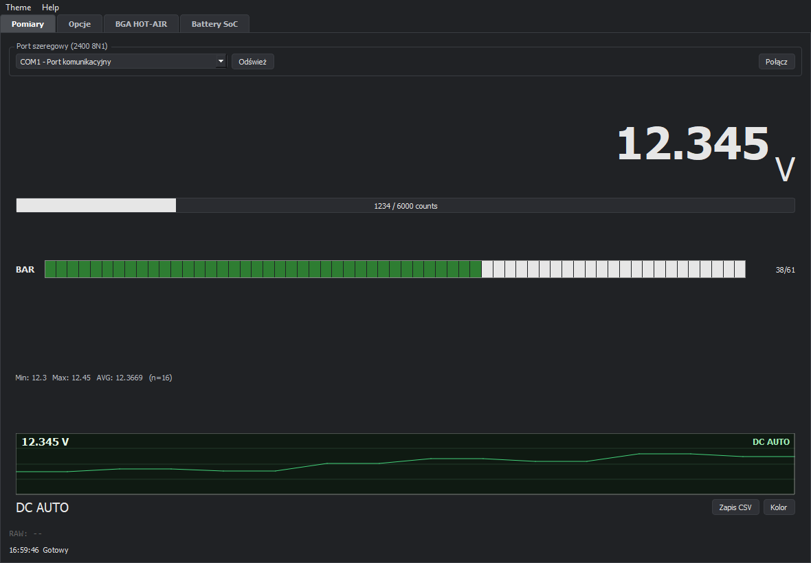
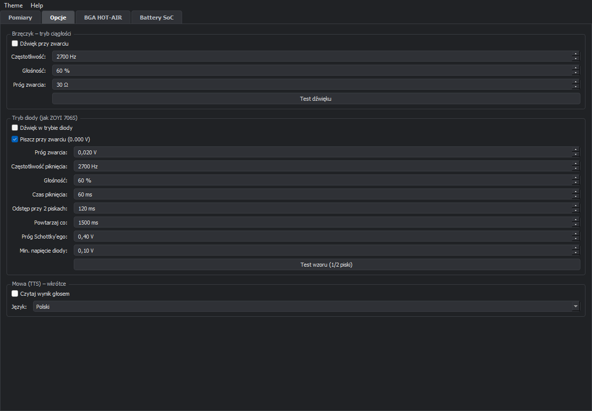
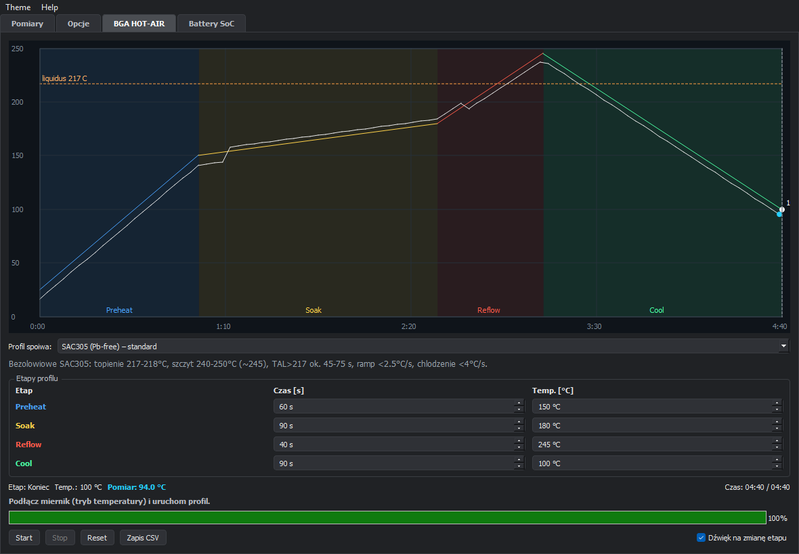
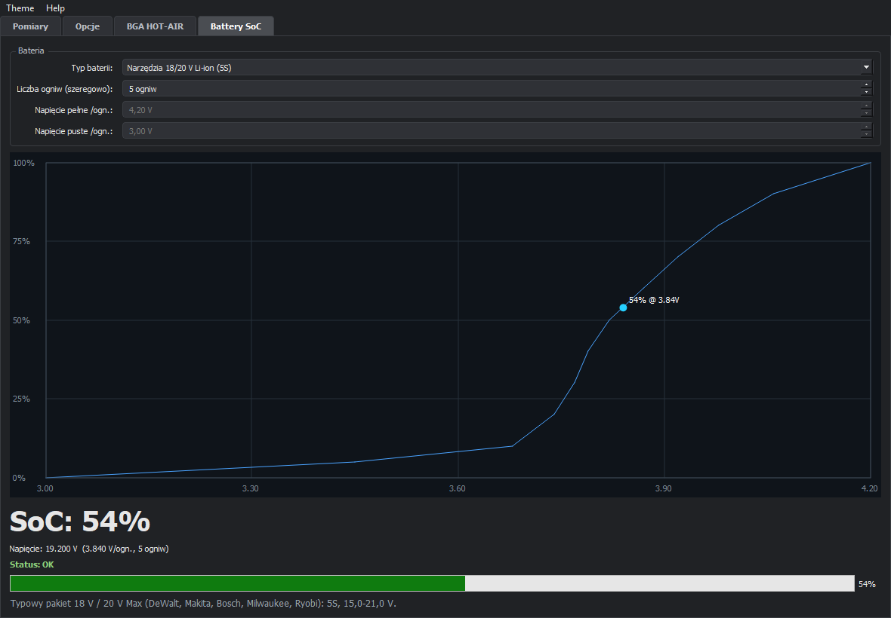

# VICI VC99 UART — aplikacja PC

Aplikacja desktopowa dla Windows do odczytu, wizualizacji i analizy pomiarów
z multimetru **VICI VC99** podłączonego przez UART/RS232 (2400 8N1).

Poza podstawowym odczytem wartości oferuje: bargraf i trend, zapis CSV,
sygnalizację dźwiękową ciągłości i trybu diody, profil reflow **BGA HOT-AIR**
ze śledzeniem temperatury z termopary oraz estymację **SoC baterii** dla
kilkudziesięciu typów ogniw i pakietów.


[](https://github.com/pmbb81-wq/Vici-VC99-UART/releases/latest)

## Zrzuty ekranu

| Pomiary | Opcje |
|---|---|
|  |  |

| BGA HOT-AIR | Battery SoC |
|---|---|
|  |  |

## Funkcje

### Pomiary
- Duży, czytelny odczyt wartości z jednostką i prefiksem (n, µ, m, k, M).
- Skala 6000 counts, bargraf 61 segmentów, mini-wykres trendu.
- Statystyki **Min / Max / AVG** oraz licznik próbek.
- Rozpoznawanie trybów: DC, AC, AUTO, HOLD, REL, MAX/MIN, APO, BAT, diode,
  ciągłość, hFE, Hz, F, °C/°F.
- Zapis pomiarów do **CSV**, zmiana koloru wyniku, motyw jasny/ciemny.
- Wybór portu COM, odświeżanie listy portów, automatyczne łączenie.
- **FPS** i opóźnienie od ostatniej ramki w pasku statusu.
- Surowa ramka w formacie HEX (diagnostyka).

### Opcje
- **Brzęczyk ciągłości** — próg rezystancji, częstotliwość, głośność, test.
- **Tryb diody (jak ZOYI 706S)** — 1 pisk dla zwykłej diody, 2 piski dla
  Schottky'ego, ciągły ton przy zwarciu; regulowane czasy pisków i przerwy.
- Mowa (TTS) — miejsce zarezerwowane na przyszłą funkcję.

### BGA HOT-AIR
- Czteroetapowy profil lutowania: **Preheat → Soak → Reflow → Cool**.
- Edytowalne czasy i temperatury każdego etapu.
- Gotowe presety: SAC305 (standard i rework), Sn63Pb37, Sn42Bi58.
- Wykres profilu z linią **liquidus** oraz nałożonym pomiarem rzeczywistym
  z termopary multimetru.
- Podpowiedzi na żywo (za zimno / za gorąco / OK), dźwięk przy zmianie etapu
  i na końcu profilu.
- Logowanie przebiegu do **CSV** i eksport wykresu do **PNG/JPG**
  (prawy przycisk myszy na wykresie).

### Battery SoC
- **33 profile** ogniw i pakietów: Li-ion/LiPo, LiHV, LiFePO4, NiMH, NiCd,
  NiZn, alkaliczne, Zn-C, Li-FeS2, srebrowe, cynkowo-powietrzne,
  CR2032/CR2016/CR123A, LR44, 9 V (alkaliczna/NiMH/litowa),
  pakiety narzędziowe 12/18/20/36/60 V, NiCd/NiMH 12/14,4/18 V,
  LiPo RC 2S/3S/6S, ołowiowe 6/12/24 V oraz LiFePO4 12/48 V.
- Automatyczne ustawianie liczby ogniw przy wyborze profilu.
- Napięcie całkowite i **V/ogniwo**, SoC z krzywej rozładowania,
  status (Pełna / OK / Niska / Krytyczna) i wykres charakterystyki.
- Profil własny (liniowy) oraz zapamiętywanie ustawień.

## Sprzęt i protokół

- Multimetr **VICI VC99** z wyjściem RS232 (lub przejściówką USB-RS232).
- Układ pomiarowy: **Fortune FS9922-DMM4**.
- Transmisja: **2400 baud, 8 bitów, bez parzystości, 1 bit stopu**.
- Ramka: **14 bajtów**, zakończona `0D 0A`.
- Zliczenia: 6000 counts, bargraf 61 segmentów.
- Przepływność: ok. **17 ramek/s** (~58 ms na ramkę).

Szczegóły dekodowania bajtów opisuje `vici_vc99_protocol.txt` oraz noty
aplikacyjne w kodzie (`vc99_parser.py`).

## Instalacja (gotowy EXE)

Pobierz najnowszą wersję:
**[Releases → VICI_VC99_FINAL.exe](https://github.com/pmbb81-wq/Vici-VC99-UART/releases/latest)**

1. Wejdź w zakładkę **Releases** tego repozytorium.
2. Pobierz `VICI_VC99_FINAL.exe`.
3. Podłącz multimetr, uruchom program i wybierz port COM.

Program nie wymaga instalacji Pythona ani dodatkowych bibliotek.

## Uruchomienie ze źródeł

```powershell
python -m pip install -r requirements.txt
python vici-vc99-py/src/main.py
```

Wymagania: Python 3.9+ oraz PyQt5 i pyserial (patrz `requirements.txt`).

## Budowa pliku EXE

```powershell
cd vici-vc99-py/src
pyinstaller --clean --onefile --windowed --hidden-import PyQt5.QtSerialPort --name VICI_VC99_FINAL main.py
```

Gotowy plik pojawi się w `vici-vc99-py/src/dist/VICI_VC99_FINAL.exe`.

## Struktura projektu

```
.
├── README.md
├── requirements.txt
├── docs/
│   └── screenshots/            # zrzuty ekranu do README
├── vici_vc99_protocol.txt      # notatki o protokole ramki
└── vici-vc99-py/
    └── src/
        ├── main.py             # okno główne i wszystkie zakładki
        ├── widgets.py          # bargraf, trend, wykres BGA, krzywa baterii
        ├── buzzer.py           # generowanie tonów i wzorów pisków (winsound)
        ├── vc99_parser.py      # parser 14-bajtowej ramki
        ├── serial_device.py    # obsługa QSerialPort
        ├── applog.py           # logowanie i przechwytywanie wyjątków
        └── VICI_VC99_FINAL.spec
```

## Znane ograniczenia

- Parser nie mapuje kodu przecinka `0x33` (według noty „000.0”) — w rzadkim
  przypadku może to zawyżyć wartość 10×.
- Tryb temperatury obsługuje termoparę **typu K**.
- SoC baterii jest estymacją napięciową — obciążenie, temperatura i wiek
  ogniwa wpływają na wynik.
- Dźwięki korzystają z `winsound`, więc działają tylko w Windows.

## Autor

**Krzysztof Nowacki** — [github.com/pmbb81-wq](https://github.com/pmbb81-wq)

---

### English summary

Windows desktop app for the VICI VC99 multimeter (UART, 2400 8N1).
Features: live reading with bargraph/trend, min/max/avg, CSV logging,
continuity and diode buzzers, a BGA reflow profile tab with live
thermocouple tracking, and battery SoC estimation with 33 chemistry/pack
profiles. Built with Python and PyQt5; a standalone EXE is available in
Releases.
